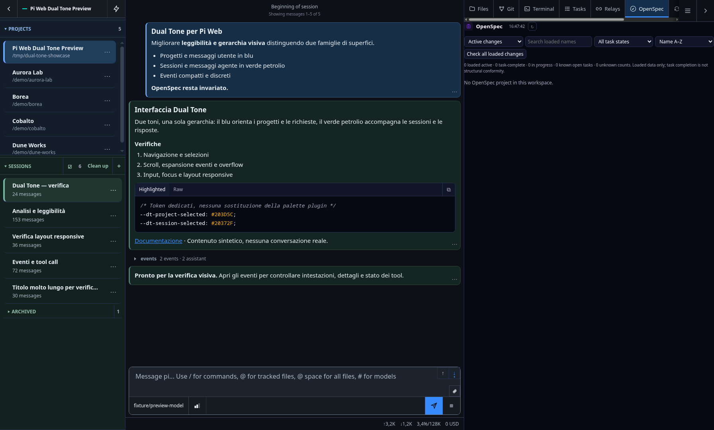
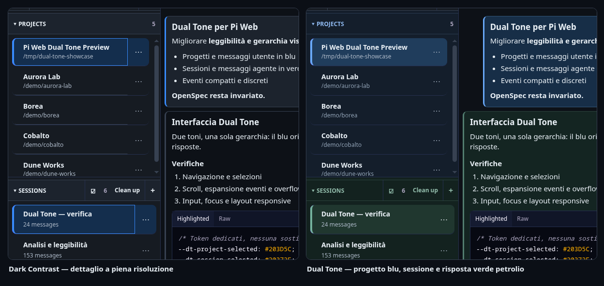
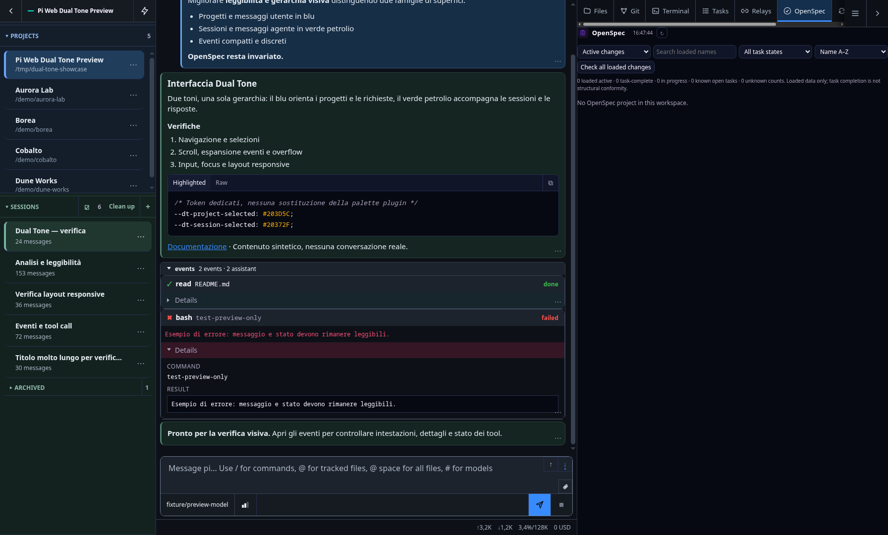
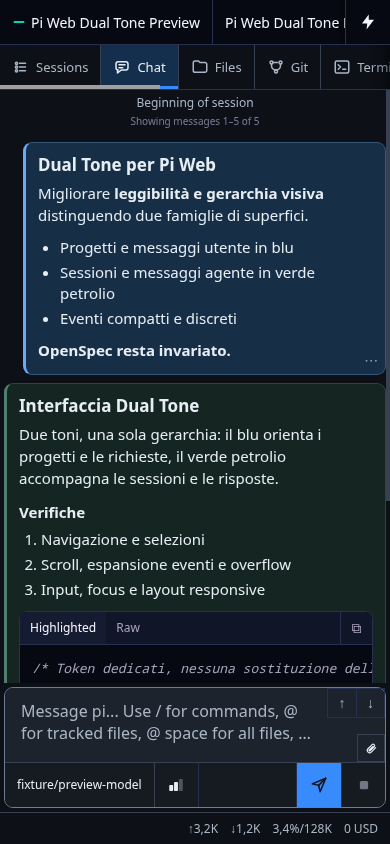

# Dual Tone — a two-tone dark theme for Pi Web

A dark theme for [Pi Web](https://pi-web.dev) that separates the interface into two
readable families: **blue for projects and your messages**, **deep teal for sessions and
agent replies**. The event log stays compact and quiet, and **your plugins are not restyled**.



<sub>Real rendering of the isolated test harness: synthetic projects, sessions and messages, no workspace data.</sub>

## Two tones, one hierarchy

| Surface | Colour | What it does |
| --- | --- | --- |
| User messages | `#172E47` | Your turns sit on a blue card, slightly indented, with a blue leading edge |
| Agent messages | `#142522` | Replies sit on a petrol-green card, with a muted teal edge |
| Projects panel | `#141E2B` | Night-blue navigation surface |
| Sessions panel | `#13221F` | Petrol-green navigation surface |
| Selected project | `#203D5C` | Deep blue row with a light blue edge |
| Selected session | `#20372F` | Deep teal row with a light teal edge |
| Events | transparent | 12px label, 26px row; a panel only on hover or when expanded |

The rest of the interface keeps a neutral dark base: background `#0D1117`, sidebar
`#161B22`, panels `#1C232D`, borders `#374151`, text `#E6EDF3`, secondary text
`#AAB6C5`, accent `#388BFD`. Text pairs meet WCAG AA; selection edges and the composer
border meet the 3:1 non-text contrast requirement.



<sub>Left: Dark Contrast (unchanged). Right: Dual Tone. Same synthetic content, same viewport.</sub>

## Why plugins are not restyled

A selected Pi Web theme replaces the global palette, and plugins inherit it. To keep
plugin UIs (OpenSpec and others) on their own colours, Dual Tone ships a **byte-identical
copy of the official PI WEB Dark palette** (`assets/base-pi-web-dark.css`) and overlays
only rules scoped to core components (`:host(chat-view)`, `:host(session-list)`, …).

No `--pi-*` variable is redefined and no plugin content selector is targeted. Verified:
the real OpenSpec panel keeps its computed colours, fonts and all 58 inherited `--pi-*`
tokens while Dual Tone is applied.

## Install

```bash
pi install npm:pi-web-dual-tone
```

Reload the browser, then choose **Settings → General → Theme → Dual Tone** and press
**Use in this browser** (one device) or **Set gateway default** (everyone on that gateway).
No session-daemon restart is needed: it is a declarative theme.

Dual Tone and Dark Contrast were observed together in the same theme picker during
verification; each keeps its own plugin ID, theme ID and stylesheet.

## Compatibility

| Item | Value |
| --- | --- |
| Tested with Pi Web | `1.202611.2` (commit `07b7665`) |
| Runtime code | none — CSS-only, declarative theme |
| Restart needed | no; a browser reload is enough |
| Coexistence | independent plugin ID `dual-tone`, theme ID `dual-tone` |

Some core chrome and CodeMirror selectors are still experimental in Pi Web, so re-check
the appearance after a Pi Web upgrade. If a future release adds new palette tokens,
refresh the bundled official baseline (`assets/base-pi-web-dark.css`).

## Verification

- Static suite: 41/41 (`npm test`) — manifest, palette regression, selector scope, WCAG
  contrast, byte-identical baseline, generated sheet.
- Browser matrix: 32/32 checks at 1792, 1381, 1024, 390 and 320 CSS pixels; one declared
  skip at phone widths (project label typography is verified on desktop).
- Real Firefox session: theme picker lists both themes, switching Dark Contrast → Dual Tone
  and back works without a reload, OpenSpec keeps its palette.
- Coexistence: `/api/themes` exposes `dark-contrast:dark-contrast` and `dual-tone:dual-tone`;
  each selection serves only its own stylesheet, with zero cross-theme tokens.





Full report: [`tests/evidence/verification.md`](tests/evidence/verification.md) (Italian).
Evidence: `tests/evidence/matrix.json`, `tests/evidence/coexistence.json`.

## Uninstall / rollback

Pick another theme in Settings (or **Use the default** in that browser), then:

```bash
pi remove npm:pi-web-dual-tone
```

No data, session or preference is migrated: removing the package only removes the theme.

## Development

```bash
npm run build   # regenerates assets/theme.css (baseline + tokens + scoped rules)
npm test        # static checks: metadata, palette, selector isolation, contrast
```

| Path | Content |
| --- | --- |
| `assets/base-pi-web-dark.css` | official PI WEB Dark palette, unmodified (sha256 `88b39cf2…7692`) |
| `assets/tokens.css` | `--dt-*` palette used by the scoped rules |
| `assets/dual-tone.css` | core-only rules |
| `assets/theme.css` | generated; the single sheet Pi Web publishes atomically |
| `tests/` | static checks, isolated preview harness, verification evidence |
| `docs/` | screenshots used by this README |

The isolated preview mounts the package as `data/plugins/dual-tone` in a temporary Pi Web
data directory; it never reads the operating instance, its sessions or its configuration.

## Attribution

Dual Tone is derived from **Dark Contrast** by diniket
([diniket/pi-web-dark-contrast](https://github.com/diniket/pi-web-dark-contrast), MIT),
branch `preview/chat-hierarchy`, commit `35f3577`. The Dark Contrast project remains
unchanged and separately published; this repository is an independent theme.

The bundled baseline is the official PI WEB Dark palette from
[`@jmfederico/pi-web`](https://www.npmjs.com/package/@jmfederico/pi-web), MIT.

## License

MIT
